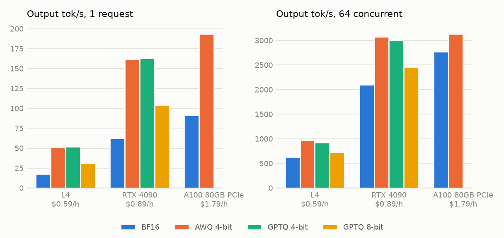
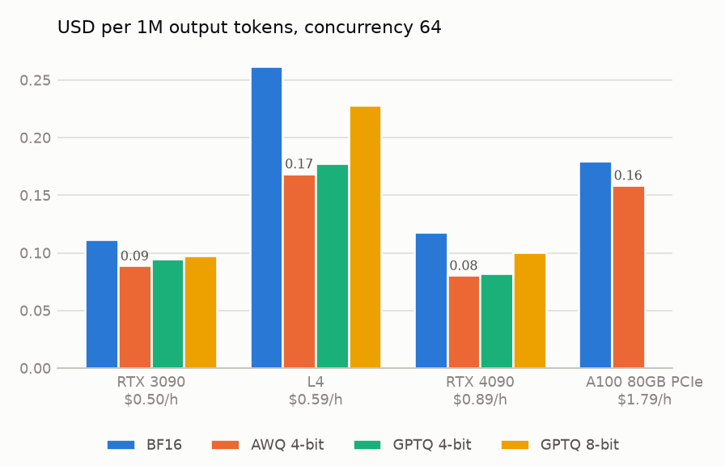
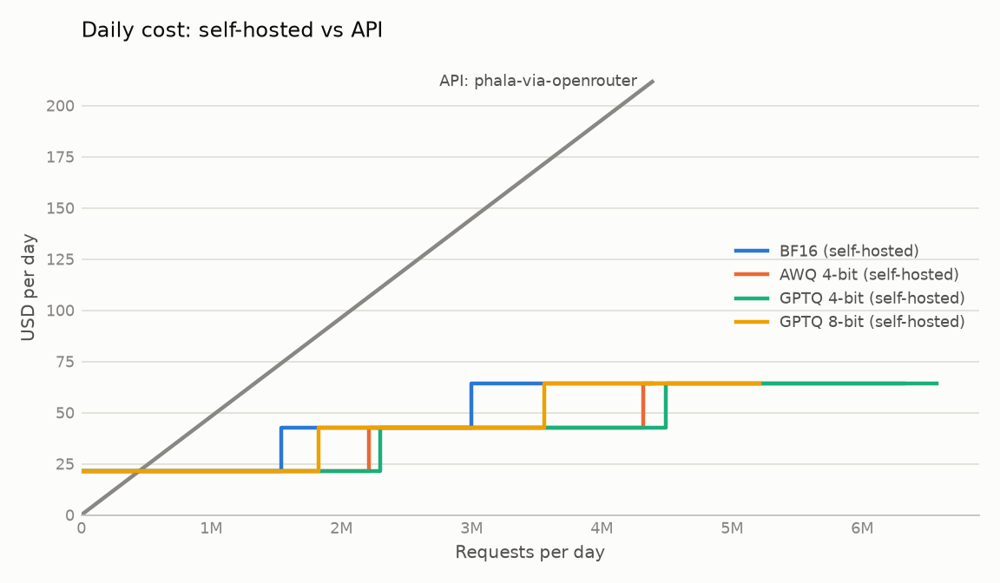
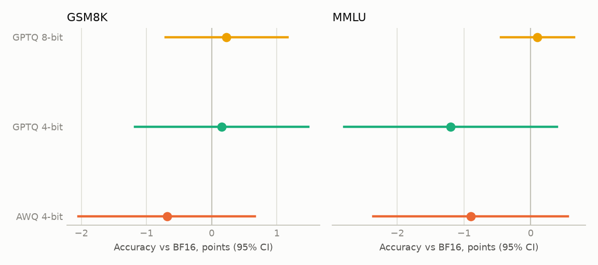

# Results: what quantisation costs and saves on affordable GPUs

> **Status: draft, 2026-10-16.** The RTX 3090 tier is still running; its figures are marked
> *pending* and will be added unchanged in method. Everything else below is final for this
> study. The method was fixed before the first measurement in
> [study-protocol.md](study-protocol.md); every change made after that is listed at the end
> of that document, with its reason.

One model, **Qwen2.5-7B-Instruct**, served with **vLLM 0.30.0** in four formats: BF16 (the
baseline, as published), AWQ 4-bit, GPTQ 4-bit and GPTQ 8-bit, all from Qwen's own repositories
and pinned by revision. Each GPU tier ran every format on a single rented pod (RunPod Secure
Cloud), with the same pinned scripts. Every number on this page is generated from the saved
result files by [`analyse_study.py`](../scripts/analyse_study.py) and
[`compare_tiers.py`](../scripts/compare_tiers.py); nothing is typed in by hand.

## Summary

- **No format showed a detectable accuracy loss.** On GSM8K (1,319 items) and an MMLU subset
  (1,000 items), every quantised format's difference from BF16 was within run-to-run noise on
  both GPUs that ran the quality tests. The comparisons could detect differences of about
  1–2.3 points; smaller losses cannot be ruled out.
- **4-bit is 2.1–2.9× faster for a single user and 1.1–1.6× faster under load** than BF16 on
  the same GPU.
- **The cheapest GPU per hour was the most expensive per token.** At 64 concurrent requests an
  RTX 4090 (USD 0.89/h) produced output tokens at about half the cost of an L4 (USD 0.59/h) or
  an A100 (USD 1.79/h): USD 0.08 per 1M with AWQ, against 0.17 and 0.16.
- **Self-hosting beats the only per-token API for this model only at high, steady traffic:**
  about 440,000 requests a day on an RTX 4090 (21–30% of its measured capacity, around the
  clock), and more on the other GPUs.
- **The API's quality matched the self-hosted baseline,** but its outputs diverged from it as
  much as a 4-bit format's do, and the provider does not say what precision it serves.

## What to do differently

For a 7B-class model served with vLLM, on tasks like these:

- **Pick a GPU by cost per token at your load, not by hourly price.** The cheapest card to rent
  was the most expensive to run. Measure your own endpoint before choosing:
  `frugal-llm bench` takes one command, and the hourly rate turns its throughput into a cost.
- **Quantise.** 4-bit weights showed no detectable accuracy loss here and were up to 2.9×
  faster. If you cannot accept a possible one-point loss on knowledge questions, GPTQ 8-bit's
  accuracy stayed within run-to-run noise of BF16 and it was still 1.1–1.8× faster.
- **Below a few hundred thousand requests a day, pay per token,** if a provider serves the
  model you want. Above that, a single rented RTX 4090 is cheaper, provided the traffic is
  steady enough to keep it busy.
- **Do not assume an API will keep serving a given model, or serve it at full precision.**
  Of three providers listing this model, one served it per token; it did not say at what
  precision, and its answers diverged from full precision as much as a 4-bit model's.
- **Check what transfers.** Arithmetic and multiple-choice knowledge are narrow. If your
  workload is different (long context, code, open-ended writing), these quality results may
  not hold for it, and the speed results depend on your prompt and output lengths.

## What this is not

Not new: engine comparisons and quantisation evaluations are plentiful, from peer-reviewed
vLLM-against-TGI studies to vendor benchmarks. Nothing here is claimed to be first. What this
study adds is a measurement on GPUs people can afford to rent, with quality loss measured
alongside speed and cost, by a method fixed in advance, from raw data anyone can check.

## 1. The harness

The study is fully rerunnable from this repository: the vLLM image is pinned
(`vllm/vllm-openai:v0.30.0`), the weights are pinned by revision, each pod fetched the cell
scripts from a fixed commit, and frugal-llm itself was installed at a fixed version (0.2.1).
Each result file records the GPU, driver, engine version, the server's own description of the
model, the hourly rate and its date. Raw results are committed with the release that follows
this study, so every table and chart can be regenerated, or checked, without rerunning
anything.

The GPU time for the whole study cost about USD 4 *(final figure pending the RTX 3090 tier)*,
and the API quality check about USD 0.10.

## 2. Speed on affordable GPUs

| GPU | USD/hour | BF16 | AWQ 4-bit | GPTQ 4-bit | GPTQ 8-bit |
|---|---:|---:|---:|---:|---:|
| | | *output tokens/s, one request at a time* | | | |
| L4 | 0.59 | 17.6 | 51.5 | 51.8 | 31.3 |
| RTX 4090 | 0.89 | 62.4 | 162.0 | 162.8 | 104.2 |
| A100 80GB PCIe | 1.79 | 91.5 | 193.6 | — | — |
| RTX 3090 | 0.50 | *pending* | *pending* | *pending* | *pending* |
| | | *output tokens/s, 64 concurrent requests* | | | |
| L4 | 0.59 | 626 | 972 | 924 | 719 |
| RTX 4090 | 0.89 | 2,102 | 3,075 | 3,000 | 2,464 |
| A100 80GB PCIe | 1.79 | 2,772 | 3,134 | — | — |
| RTX 3090 | 0.50 | *pending* | *pending* | *pending* | *pending* |

The A100 is a reference point and ran latency only (BF16 and AWQ). Each figure is the median
of three repeats; the full tables, with time to first token and inter-token latency at 1, 4,
16 and 64 concurrent requests, are in each tier's summary.



Quantisation helps most where a GPU is short of memory bandwidth: a single user on the L4 gets
2.9× the speed from 4-bit weights. Under heavy load the gain shrinks as the GPU becomes
compute-bound: on the A100, AWQ is only 1.13× BF16 at 64 concurrent requests, and an A100
running AWQ is barely faster than an RTX 4090 running it (3,134 against 3,075 tokens/s).

## 3. Cost

Cost per 1M output tokens is the hourly rate divided by measured output throughput: the GPU
kept fully busy at that load. At 64 concurrent requests:

| GPU | USD/hour | BF16 | AWQ 4-bit | GPTQ 4-bit | GPTQ 8-bit |
|---|---:|---:|---:|---:|---:|
| L4 | 0.59 | 0.262 | 0.169 | 0.177 | 0.228 |
| RTX 4090 | 0.89 | 0.118 | **0.080** | 0.082 | 0.100 |
| A100 80GB PCIe | 1.79 | 0.179 | 0.159 | — | — |
| RTX 3090 | 0.50 | *pending* | *pending* | *pending* | *pending* |



Hourly price does not rank cost per token; throughput does. The RTX 4090 costs 51% more per
hour than the L4 but produces 3.2–3.4× the tokens.

### Against an API

The comparison is against an API serving **the same model**, so that only the price differs.
On 2026-10-16 the only live per-token provider of Qwen2.5-7B-Instruct found was **Phala via
OpenRouter**, at USD 0.10 per 1M input and 0.20 per 1M output tokens. Together AI still lists
the model at USD 0.30/0.30 but no longer serves it per token (requests are refused unless an
hourly dedicated endpoint is rented), and DeepInfra lists it as deprecated. Per-token access
to a specific, slightly older model can disappear; a self-hosted copy cannot.

Requests are compared whole, at the shape measured (about 233 tokens in and 120 out). At 64
concurrent requests, self-hosting becomes cheaper than the API above:

| GPU | Break-even traffic, requests/day | Utilisation needed, around the clock |
|---|---:|---:|
| RTX 4090 | about 440,000 | 21% (4-bit) to 30% (BF16) |
| L4 | about 300,000 | 44% (4-bit) to 67% (BF16) |
| A100 80GB PCIe | about 890,000 | 41% (AWQ) to 46% (BF16) |
| RTX 3090 | *pending* | *pending* |

Break-even traffic barely depends on the format, because one instance is rented either way;
the format changes how much of that instance the traffic uses, and so how much headroom is
left before a second one is needed.



Not included: idle time, engineering time, storage and egress, which all favour the API. The
utilisation figure is the assumption everything rests on; the method is in
[cost-method.md](cost-method.md).

## 4. Quality against BF16

Greedy decoding (temperature 0, top_p 1, seed 0), at most 1,024 output tokens, 16 requests at
a time, scored by fixed rules ([quality-method.md](quality-method.md)). BF16 ran twice on each
GPU; the second run is the noise floor, showing how much answers change with nothing changed.
Differences are paired (same items), with 95% confidence intervals and Holm-corrected exact
McNemar tests.

| Format | GPU | GSM8K, points vs BF16 (95% CI) | MMLU, points vs BF16 (95% CI) |
|---|---|---:|---:|
| AWQ 4-bit | RTX 4090 | −0.7 (−2.0 to +0.7) | −0.9 (−2.4 to +0.6) |
| | L4 | −0.8 (−2.2 to +0.5) | −0.9 (−2.4 to +0.6) |
| GPTQ 4-bit | RTX 4090 | +0.2 (−1.2 to +1.5) | −1.2 (−2.8 to +0.4) |
| | L4 | −0.2 (−1.5 to +1.2) | −1.1 (−2.7 to +0.5) |
| GPTQ 8-bit | RTX 4090 | +0.2 (−0.7 to +1.2) | +0.1 (−0.4 to +0.6) |
| | L4 | −0.2 (−1.1 to +0.8) | +0.0 (−0.8 to +0.8) |
| RTX 3090, all formats | | *pending* | *pending* |

BF16 itself scored 91.4% and 91.7% on GSM8K (RTX 4090, L4; Qwen reports 91.6%) and 73.8% on
MMLU on both.

**No difference was detected for any format on either GPU.** Every interval includes zero, and
differences under about 1.0–2.3 points (depending on the comparison) are below this study's
resolution, so "no difference detected" is not "no loss".

Both 4-bit formats come out about one point lower on MMLU on both GPUs. Because both GPUs
answered the same questions, this agreement shows the result is reproducible; it is not a
second, independent sample, and it does not make the difference significant. A larger
question set would be needed to say whether a one-point MMLU loss is real.



### Different is not worse

Quantised formats change answers far more than they change accuracy:

| | GSM8K, same final answer as BF16 | MMLU, same final answer as BF16 |
|---|---:|---:|
| BF16 rerun (noise floor) | 96.4–97.0% | 99.0–99.5% |
| GPTQ 8-bit | 95.5–95.6% | 98.3–99.3% |
| AWQ / GPTQ 4-bit | 91.6–92.5% | 91.1–92.3% |

(Ranges span the two GPUs.) 8-bit is close to the noise floor; 4-bit changes about one answer
in twelve, gaining roughly as many right answers as it loses.

### The API

The same quality runs against Phala via OpenRouter scored 92.6% on GSM8K and 74.1% on MMLU:
+1.1 points (−0.2 to +2.5) and +0.3 (−0.7 to +1.3) against the RTX 4090 BF16 baseline, so no
difference was detected. Its outputs, however, matched the baseline's final answer on only
92.3% of GSM8K items and were word-for-word identical on 0.5%, which is the divergence of a
4-bit format, not of a BF16 rerun. The provider is serving something other than this exact
configuration (a different precision, engine or both) and does not report which. The cost
comparison above is therefore like for like in measured accuracy, not in serving setup.

## 5. Limitations

As stated in the protocol before any result: one model and one engine; quality covers
arithmetic reasoning and recalled knowledge only, on public sets that may be in training data;
one provider and one date for prices; closed-loop synthetic load. In addition, found during the
study:

- The API's precision is unreported, and only one per-token provider of this model existed.
- Recording which upstream served each API request (`served_by`) was added to frugal-llm
  after this study's API run; at the time, Phala was the only provider listed, and served a
  test request.
- Tier 1 ran on an RTX 4090 when the planned RTX 3090 could not be placed; the RTX 3090 was
  run afterwards and is reported alongside it, not instead of it.

## Reproducing

```bash
uv run --with matplotlib python scripts/analyse_study.py results/t1-rtx4090 \
    --tier t1-rtx4090 --out results/analysis/t1-rtx4090 \
    --api "name=phala-via-openrouter,in=0.10,out=0.20,source=https://openrouter.ai/api/v1/models/qwen/qwen-2.5-7b-instruct/endpoints,date=2026-10-16"
uv run --with matplotlib python scripts/compare_tiers.py \
    results/t1-rtx4090 results/t2-l4 results/ref-a100 --out results/analysis/tiers
```

Each GPU cell is [`scripts/run_cell.sh`](../scripts/run_cell.sh), run on a pod by
[`scripts/pod_entry.sh`](../scripts/pod_entry.sh).
